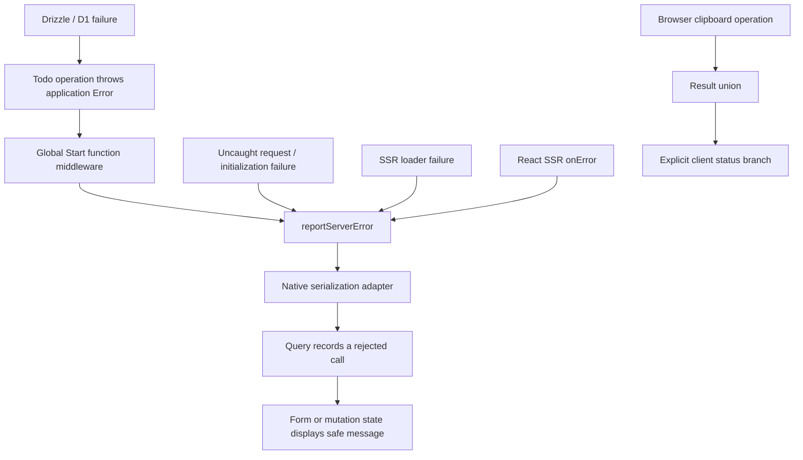

# Error handling

This representative implementation covers authenticated todo reads and writes,
form submissions, a delete confirmation, and copying a todo title in the browser.
Use it as the pattern when extending the template. The upstream investigation,
including installed-version caveats, is in [ERROR_HANDLING_RESEARCH.md](ERROR_HANDLING_RESEARCH.md).

## Contracts

| Code                                                           | Failure contract                                         | Consumer                                      |
| -------------------------------------------------------------- | -------------------------------------------------------- | --------------------------------------------- |
| Database operations and server logic                           | Throw an `Error` instance                                | Native Start middleware                       |
| Server functions, Query query functions and mutation functions | Reject with an `Error`; return ordinary data on success  | TanStack Query and Router                     |
| Ordinary client operations                                     | Resolve `Result<Data, SpecificError>`                    | Explicit `status` branch in the event handler |
| Query hooks                                                    | Preserve Query's native discriminated result             | `isError`, `isSuccess`, or `status`           |
| Form submissions                                               | Await `mutateAsync`; let rejection reach the shared form | Inline error; keep the draft                  |
| Rendering and initial route loading                            | Use Router's error boundary                              | Safe fallback with recovery                   |

Query functions must reject: returning `{ error }` from a query or mutation
function would cache it as successful data. The Query hook result itself already
has a discriminated union. Do not add an additional result wrapper around it.
[Query functions](https://tanstack.com/query/latest/docs/framework/react/guides/query-functions),
[Query TypeScript](https://tanstack.com/query/latest/docs/framework/react/typescript).



There are no per-operation error-handling decorators. `createServerFn` handlers
retain their validation, authentication middleware, and direct operation calls.
Global middleware is configured once in `src/app/start.ts`.

## Error categories and codes

Classes live in `src/shared/errors`. A category represents a recovery policy;
codes identify cases within that category. Create new **instances**, with stable
codes, for individual failures. A reference ID identifies one reported occurrence.

| Class                  | Status | Example code                      | Typical handling                                        |
| ---------------------- | ------ | --------------------------------- | ------------------------------------------------------- |
| `ValidationError`      | 400    | `INVALID_INPUT`                   | Correct input                                           |
| `AuthenticationError`  | 401    | `SESSION_REQUIRED`                | Sign in again                                           |
| `AuthorizationError`   | 403    | `ACTION_FORBIDDEN`                | Explain unavailable access                              |
| `NotFoundError`        | 404    | `TODO_NOT_FOUND`                  | Refresh or leave a stale record                         |
| `ConflictError`        | 409    | `RECORD_CHANGED`                  | Refresh and reconcile                                   |
| `DependencyError`      | 503    | `TODO_UPDATE_FAILED`              | Explain a dependency failure; inspect the server report |
| `ClientOperationError` | 500    | `CLIPBOARD_WRITE_FAILED`          | Recover locally                                         |
| `UnexpectedError`      | 500    | `TODO_CREATE_EMPTY`, `UNEXPECTED` | Generic message and reference ID                        |

The current flow exercises validation, authentication, missing records,
dependencies, local browser failures, and unexpected failures. Authorization and
conflict are available categories; the todo flow does not invent those cases.
Status describes the category. Start owns the RPC envelope and its transport
status; callers should use the decoded error class and code.

```ts
throw new NotFoundError("TODO_NOT_FOUND", "Todo not found");

throw new DependencyError("TODO_UPDATE_FAILED", "Unable to save your todo. Please try again.", {
  cause: error,
});
```

Every application error message is deliberately safe to display. Put vendor
exceptions and internal details in `cause`, never interpolate them into the
public message. Unclassified errors become `UnexpectedError` with the generic
message. Do not instantiate the abstract `AppError` base.

`errorClasses` is the single reconstruction registry. Add a category there and
to its status mapping when a new recovery policy warrants it; use another code
for another instance of an existing policy.

## Database and validation

The todo operations translate rejected Drizzle operations into `DependencyError`,
preserving the original exception as `cause`. There is no driver wrapper and no
schema migration. Empty lists remain successful empty lists. An update or delete
that returns no owned row throws `NotFoundError`, whether the ID is absent or
belongs to another user. An insert that unexpectedly returns no row throws
`UnexpectedError`.

Drizzle's `DrizzleQueryError` contains the query and parameters in its message.
Those details must not become UI text or serialized error properties. This
implementation does not guess SQLite constraint categories from vendor messages.
If a future operation needs conflict recovery, translate a verified driver signal
to `ConflictError` at that operation.
[Drizzle source](https://github.com/drizzle-team/drizzle-orm/blob/main/drizzle-orm/src/errors.ts),
[D1 error handling](https://developers.cloudflare.com/d1/observability/debug-d1/).

Todo server functions use Start's native functional validator:

```ts
.validator((input: UpdateTodoInput) => updateTodoInputSchema.parse(input))
```

This is intentional: the installed Start Standard Schema validator throws a plain
`Error` containing serialized issues, while `.parse()` preserves `ZodError`.
Global middleware can then classify it as `ValidationError("INVALID_INPUT", ...)`
without parsing error-message text. Browser forms still pass Zod schemas directly
to their Standard Schema validators.
[Start validation](https://tanstack.com/start/latest/docs/framework/react/guide/server-functions),
[Start validator implementation](https://github.com/TanStack/router/blob/main/packages/start-client-core/src/createServerFn.ts),
[Zod errors](https://zod.dev/error-customization).

## Reporting and transport

`reportServerError` in `src/shared/errors/report.server.ts` is the single reporting
sink. It uses the active Start request context for deduplication when one exists.
Outside a request, it logs each call without deduplication. The following native
hooks feed it:

1. Global function middleware: handler, validation, authentication and operation
   failures, including direct server-function calls during SSR.
2. Global request middleware: failures escaping HTTP handlers or the request pipeline.
3. The custom server entry: initialization failures and errors Router consumed
   during SSR loading.
4. React's streaming `onError`: recoverable and fatal SSR rendering failures.
5. The serialization adapter: a final normalization point for serialized Errors,
   including errors retained in Router's hydration state.

Reports include category, code, reference ID, status and stack frames. Expected
client-correctable failures log at warning level; server failures log at error
level. Routine logs omit raw messages, request bodies, cookies, SQL, parameters
and cause contents. The original cause remains available inside the request if
a future reporting integration needs a separately reviewed payload.

Deduplication uses error identity **within each Request**. Crossing multiple hooks
keeps the same reference ID and emits one report. Reusing an Error in another
request produces another report. Request keys are weakly held.

The server entry's outer `createServerEntry` scope remains active in its error
catch even after the inner handler rejects asynchronously. Keep response helpers
inside that scope so `handleStartError` preserves their state. A regression test
uses the real Start context implementation to verify this behavior.

The native serialization adapter sends only `kind`, `code`, safe `message` and
`referenceId`. It reconstructs the category class, so `instanceof NotFoundError`
works after RPC and hydration. Server `stack` and `cause` never cross that adapter.
Start's default error serializer would lose custom classes and codes.
[Native serialization adapter API](https://github.com/TanStack/router/blob/main/packages/router-core/src/ssr/serializer/transformer.ts).

Global request middleware retains Start's explicit CSRF middleware. Redirects,
Router not-found signals and thrown HTTP Responses keep their native control-flow
semantics. These framework signals are exceptions to the application Error rule.
[Start middleware](https://tanstack.com/start/latest/docs/framework/react/guide/middleware).

The server entry preserves `createServerEntry` and `handleStartError`. Its final
HTTP fallback carries `X-Error-Reference`. The Workers renderer uses React Web
Streams with Router's hydration transform, stream response ownership, nonce,
abort handling and bot readiness. Its React error digest is the reference ID.
This small renderer is specific to the template's Cloudflare Workers target;
review it against upstream when upgrading Router or changing runtimes.
[Server entry](https://tanstack.com/start/latest/docs/framework/react/guide/server-entry-point),
[React streaming errors](https://react.dev/reference/react-dom/server/renderToReadableStream#logging-crashes-on-the-server).

No application catch can observe a Worker that fails to boot. Platform logs remain
necessary for boot failures. New scheduled, queue or background-task entry points
need reporting in their own execution context. A failure after streaming starts
cannot replace the already-sent HTTP status; it can still be reported by React.
Returned HTTP error responses and deliberately swallowed failures are not thrown
exceptions and do not automatically pass through this sink.

## Client and React usage

`Result` uses the same `data` and `error` names as Query, with two final states:

```ts
type Result<Data, Failure extends Error = AppError> =
  | { status: "success"; data: Data; error?: never }
  | { status: "error"; data?: never; error: Failure };

const result = await copyTodo(todo);
if (result.status === "error") {
  setError(getErrorMessage(result.error));
  return;
}
// result.data is now a string, rather than string | undefined.
```

Return these results directly from ordinary client operations. There is no generic
`tryCatch`, `toResult` or `withErrorHandling` helper. The union requires narrowing
before consuming success data; TypeScript cannot force a caller to inspect a
result that it chooses to discard. Query also has pending states and can retain
cached data after a refetch fails; preserve that richer native result.

Form handlers await native `mutateAsync`. The shared form catches the rejected
submission and writes a safe message to Form's `errorMap.onSubmit`; it preserves
the draft and skips success effects. Its explicit retry button clears the previous
submission error before native validation runs, so an unchanged draft can be
retried after a temporary failure. It invokes the form's native `requestSubmit()`
to pass through the shared submission handler. Returning a resolved failure result from a
Form `onSubmit` would incorrectly mark it successful in the installed Form
version. `FormSubmissionError` remains supported for existing client submissions;
new ordinary client operations should use results.
[Form submission](https://tanstack.com/form/latest/docs/framework/react/guides/submission-handling).

The delete dialog uses native `mutate` and the mutation's discriminated error
state. All todo mutation hooks await query invalidation before their success
callback. Writes have no automatic retries. Read retries are disabled during SSR;
in the browser, dependency and unclassified transport failures get at most two
retries. Classified application failures such as missing records and invalid
input do not retry automatically.

Router's default error component handles initial loading and render failures.
Its recovery button resets Query's error boundary and the route boundary, then
invalidates the route. Suspense keeps its native behavior: an initial query
failure reaches the boundary; an error during a refetch may retain cached UI.
React boundaries do not replace error handling in ordinary event handlers or
asynchronous callbacks, which is why the clipboard operation returns a result.
[Router external data loading](https://tanstack.com/router/latest/docs/framework/react/guide/external-data-loading),
[Query Suspense](https://tanstack.com/query/latest/docs/framework/react/guides/suspense),
[React error boundaries](https://react.dev/reference/react/Component#catching-rendering-errors-with-an-error-boundary).

## Applying this elsewhere

1. Translate vendor failures where the vendor operation is performed. Preserve
   `cause`, choose an existing category and a stable code, and write safe messages.
2. Keep server functions and Query functions throwing. Global registration already
   supplies reporting and serialization; add no error decorator to an operation.
3. Return `Result` from ordinary client operations and branch in the consuming UI.
   For Query, keep its native hook result and handle the relevant error state.
4. Await form writes; keep success effects after the successful await. Use native
   mutation state for confirmations and other events that do not require a promise.
5. Exercise failures across the real transport and verify recovery, draft
   preservation, class reconstruction and reference IDs.

The Playwright tests reproduce a two-tab stale edit, invalid RPC input, and denied
clipboard access against the compiled Worker. Local preview needs
`BETTER_AUTH_URL=http://localhost:4173` in the generated `dist/server/.dev.vars` as
well as a local auth secret; rebuilds regenerate that file. CI explicitly sets
those disposable preview bindings before running browser tests.
