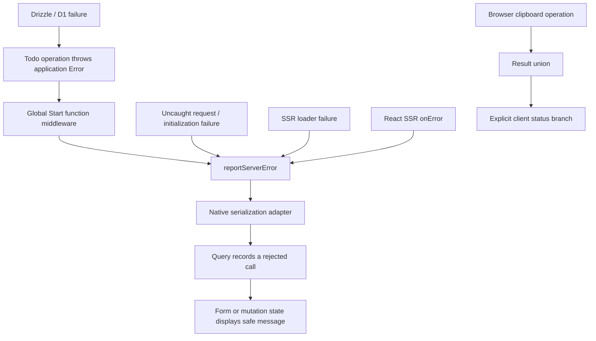

# Error handling

This representative implementation covers authenticated todo reads and writes,
form submissions, a delete confirmation, and copying a todo title in the browser.
Use it as the pattern when extending the template. The upstream investigation,
including installed-version caveats, is in [ERROR_HANDLING_RESEARCH.md](ERROR_HANDLING_RESEARCH.md).

## Contracts

| Code                                                           | Failure contract                                         | Consumer                                      |
| -------------------------------------------------------------- | -------------------------------------------------------- | --------------------------------------------- |
| Database operations and server logic                           | Throw an `Error` instance                                | Native Start middleware                       |
| Server functions, Query query functions and mutation functions | Reject with an `Error`; return ordinary data on success  | TanStack Query and Router                     |
| Ordinary client operations                                     | Resolve `Result<Data, SpecificError>`                    | Explicit `status` branch in the event handler |
| Query hooks                                                    | Preserve Query's native discriminated result             | `isError`, `isSuccess`, or `status`           |
| Form submissions                                               | Await `mutateAsync`; let rejection reach the shared form | Inline error; keep the draft                  |
| Rendering and initial route loading                            | Use Router's error boundary                              | Safe fallback with recovery                   |

Query functions must reject: returning `{ error }` from a query or mutation
function would cache it as successful data. The Query hook result itself already
has a discriminated union. Do not add an additional result wrapper around it.
[Query functions](https://tanstack.com/query/latest/docs/framework/react/guides/query-functions),
[Query TypeScript](https://tanstack.com/query/latest/docs/framework/react/typescript).



There are no per-operation error-handling decorators. `createServerFn` handlers
retain their validation, authentication middleware, and direct operation calls.
Global middleware is configured once in `src/app/start.ts`.

## Error categories and codes

Classes live in `src/shared/errors`. A category represents a recovery policy;
codes identify cases within that category. Create new **instances**, with stable
codes, for individual failures. A reference ID identifies one reported occurrence.

| Class                  | Status | Example code                      | Typical handling                                        |
| ---------------------- | ------ | --------------------------------- | ------------------------------------------------------- |
| `ValidationError`      | 400    | `INVALID_INPUT`                   | Correct input                                           |
| `AuthenticationError`  | 401    | `SESSION_REQUIRED`                | Sign in again                                           |
| `AuthorizationError`   | 403    | `ACTION_FORBIDDEN`                | Explain unavailable access                              |
| `NotFoundError`        | 404    | `TODO_NOT_FOUND`                  | Refresh or leave a stale record                         |
| `ConflictError`        | 409    | `RECORD_CHANGED`                  | Refresh and reconcile                                   |
| `DependencyError`      | 503    | `TODO_UPDATE_FAILED`              | Explain a dependency failure; inspect the server report |
| `ClientOperationError` | 500    | `CLIPBOARD_WRITE_FAILED`          | Recover locally                                         |
| `UnexpectedError`      | 500    | `TODO_CREATE_EMPTY`, `UNEXPECTED` | Generic message and reference ID                        |

The current flow exercises validation, authentication, missing records,
dependencies, local browser failures, and unexpected failures. Authorization and
conflict are available categories; the todo flow does not invent those cases.
Status describes the category. Start owns the RPC envelope and its transport
status; callers should use the decoded error class and code.

```ts
throw new NotFoundError("TODO_NOT_FOUND", "Todo not found");

throw new DependencyError("TODO_UPDATE_FAILED", "Unable to save your todo. Please try again.", {
  cause: error,
});
```

Every application error message is deliberately safe to display. Put vendor
exceptions and internal details in `cause`, never interpolate them into the
public message. Unclassified errors become `UnexpectedError` with the generic
message. Do not instantiate the abstract `AppError` base.

`errorClasses` is the single reconstruction registry. Add a category there and
to its status mapping when a new recovery policy warrants it; use another code
for another instance of an existing policy.

## Database and validation

The todo operations translate rejected Drizzle operations into `DependencyError`,
preserving the original exception as `cause`. There is no driver wrapper and no
schema migration. Empty lists remain successful empty lists. An update or delete
that returns no owned row throws `NotFoundError`, whether the ID is absent or
belongs to another user. An insert that unexpectedly returns no row throws
`UnexpectedError`.

Drizzle's `DrizzleQueryError` contains the query and parameters in its message.
Those details must not become UI text or serialized error properties. This
implementation does not guess SQLite constraint categories from vendor messages.
If a future operation needs conflict recovery, translate a verified driver signal
to `ConflictError` at that operation.
[Drizzle source](https://github.com/drizzle-team/drizzle-orm/blob/main/drizzle-orm/src/errors.ts),
[D1 error handling](https://developers.cloudflare.com/d1/observability/debug-d1/).

Todo server functions use Start's native functional validator:

```ts
.validator((input: UpdateTodoInput) => updateTodoInputSchema.parse(input))
```

This is intentional: the installed Start Standard Schema validator throws a plain
`Error` containing serialized issues, while `.parse()` preserves `ZodError`.
Global middleware can then classify it as `ValidationError("INVALID_INPUT", ...)`
without parsing error-message text. Browser forms still pass Zod schemas directly
to their Standard Schema validators.
[Start validation](https://tanstack.com/start/latest/docs/framework/react/guide/server-functions),
[Start validator implementation](https://github.com/TanStack/router/blob/main/packages/start-client-core/src/createServerFn.ts),
[Zod errors](https://zod.dev/error-customization).
